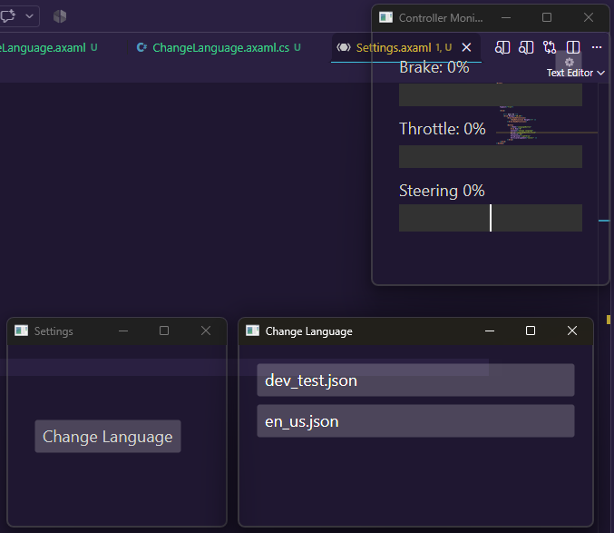

# Controller Monitor
This application is a simple transparent box for displaying common **controller** analog inputs.  

## What it shows
(These names can be changed in lang/)
- Throttle
- Brake
- Steering

## Usage
Controller is needed.

### Resizing
- You can resize it like any other program.

### Moving
- You can move it like any other program

## Notes
- I'll try to listen to good requests.
- May work on linux now! I don't have linux so I can't test
- Controller must be SDL2‑compatible!
- If anti-virus scans it then you may need to close it and reopen it for the layering to work correctly.
- If no controller is pluged in then it will instantly close.
- I plan on adding more settings later. (lang file already has the names)
- You can change the language now, though there is only english and a test language...

## Images

  

Note that this is the smallest size at the moment.

 
<EOF>
